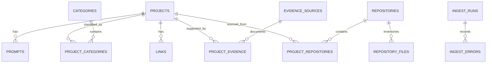

# 数据库 Schema

主数据库为 `data/catalog.sqlite`，采用 SQLite；网页端使用由数据库导出的 `site/data/catalog.json`。关系型数据库负责规范化与采集状态，JSON 负责静态网站读取。

## 实体关系

## 核心表

| 表 | 主键 | 作用 |
|---|---|---|
| `projects` | `id` | 作品本身；一条作品记录不等于一个仓库 |
| `categories` | `id` | 规范化分类词表 |
| `project_categories` | `(project_id, category_id)` | 多标签分类，保留原始分类标签 |
| `repositories` | `id` | 去重后的 GitHub 仓库，保存分支、许可证、克隆状态和 commit SHA |
| `project_repositories` | `(project_id, repository_id)` | 作品与仓库多对多映射，记录原作/镜像/合集关系和入口文件 |
| `links` | `id` | 在线演示、作者原帖等公开链接 |
| `prompts` | `id` | Prompt 的公开状态、原文链接和可选文本 |
| `evidence_sources` | `id` | 索引、帖子、原始仓库等证据来源 |
| `project_evidence` | 复合键 | 作品与证据的关系、证据类型和置信度 |
| `repository_files` | `id` | 克隆仓库的文件清单、扩展名、大小、SHA-256 和 HTML 入口标记 |
| `aliases` | 复合键 | 作品别名和历史名称 |
| `ingest_runs` | `id` | 每次采集运行的统计和状态 |
| `ingest_errors` | `id` | 克隆、解析、入口识别错误 |

## 重要字段语义

- `model_claim`：社区/作者对生成模型的声明，不等于独立验证。
- `model_confidence`：当前种子默认 `community_claim`。
- `relation_type`：`creator_original`、`third_party_mirror`、`collection`、`community_indexed_source`、`unverified_source_candidate`。
- `entry_confidence`：`explicit_override`、`source_link`、`title_path_match`、`unique_html`、`unresolved` 等。
- `playable_status=entrypoint_found`：只表示找到了 HTML 入口，不表示已经人工试玩或端到端验证成功。
- `license_spdx=NOASSERTION`：没有确认许可证；公开仓库不等于允许再分发。

## 初始数据快照

`data/seeds/games_52.tsv`、`games_51.tsv` 和 `mia_html_52.txt` 是可复现的紧凑种子清单；结合 5 个重点作品和 2 个额外单文件游戏，可重建首批 155 条作品。首轮导入后得到 54 个去重仓库、150 条作品-仓库关系。重复仓库只克隆一次，合集仓库里的多个作品仍是多条项目记录。

## 研究层表结构（2026-11-17）

基线表 projects、repositories、project_repositories 不重建、不自动提升社区模型声明。新增表的分工：

| 研究表 | 粒度与职责 |
|---|---|
| research_source_records | 按 (source, source_id) 保存当前来源快照；只计当前版本，不把旧删除数据算作新增 |
| research_posts | 精确 X status ID 作为帖子身份；缺失 ID 使用孤儿键；不等于独立游戏 |
| research_repositories | 83个 GitHub 候选仓库及与原创/镜像/工具/PR 的关系 |
| research_works | 64个作品工程映射、源码入口、Prompt/外部资源/人工贡献的源声明 |
| research_claims | 反证与模型归属冲突 |
| research_project_links | 旧目录到研究主表的保守精确映射，允许保留人工设置的关系 |
| research_work_reviews | APPROVED/DRAFT/REJECTED 的作品人工审核字段，独立于来源快照 |
| research_post_reviews | APPROVED/DRAFT/REJECTED 的原帖归并审核 |
| research_review_history | 只追加审核变更时间和依据，重复审核内容不制造伪新历史 |
| research_ingest_meta | 当前已经入库的来源快照 capture date |
| research_browser_runs | 将来真正浏览器实测的日志；空白不是已通过 |

一个 Work 可以关联多个来源帖；一个 GitHub 仓库也可能对应多款不同作品；同名和同仓库绝不能自动推断唯一作品。人工审核必须有直接证据 URL，不能修改来源冻结 JSON 再冒称作者事实。active manifest 的 SHA-256 对 sources/entities 两文件一起做内容校验，详见 RESEARCH_INTEGRATION.md。

## 运行实测状态（2026-11-17 新增）

`project_repositories.playable_status` 除既有取值外，新增两个由**隔离容器实测**得出的结论值：

| 取值 | 含义 | 是否可发布 |
|---|---|---|
| `entrypoint_found` | 找到 HTML 入口且相对静态资源齐全；**仅表示入口存在** | 是（仍需仓库在白名单内） |
| `sandbox_incompatible` | 隔离实测发现该产物在**必需的** iframe 沙箱（无 `allow-same-origin`）下会抛错（例如访问 `localStorage`），因此不可玩 | **否**，`build_site.py` 会跳过 |
| `runtime_verification_failed` | 隔离实测明确失败 | **否** |
| `not_checked` / `needs_review` / `missing_assets` / `requires_build` | 未核实或已知缺条件 | 否 |

`collect_repositories.py` 的 `RUNTIME_REVIEWED_STATUSES` 保证**重新采集不会静默把这些实测结论改回可发布**，与"来源刷新不得覆盖人工审核层"是同一条原则。把某个产物改回可发布，必须显式修改数据库并附证据。

`entry_confidence` 新增 `runtime_reviewed`，表示该行入口结论来自运行实测而非文件树推断。

### 运行证据

* 报告由 `scripts/build_runtime_evidence.py` 聚合，落在 `data/reports/runtime-evidence-<date>.json`。
* `INPUT_RESPONSIVE` = 注入合成指针/键盘输入后**渲染输出发生可观测变化**。它不证明游戏正确、完整或归属。
* 聚合器是 fail-closed 的：若报告自称通过但带有控制台错误、被阻断的功能性依赖或没有输入驱动的变化，该条会被标记 `verification_rejected`，且**不计入** `gameplay_verified`。

### 隔离实测产生的状态（2026-11-17 全量普查）

`collect_repositories.py` 的 `RUNTIME_REVIEWED_STATUSES` 保证这些值在重新采集时**不会被覆盖回可发布**：

| 取值 | 含义 | 可发布 |
|---|---|---|
| `sandbox_incompatible` | 在必需沙箱（不含 `allow-same-origin`）下**必然失败**。实测两类：初始化即读 `localStorage`；自身 ES module 因不透明源 `origin 'null'` 被判 CORS 失败 | 否 |
| `runtime_requires_network` | 依赖外部 CDN 上的真实 JS（如 `cdnjs` 的 three.js）。隔离策略下无法运行；真实浏览器可加载，属**依赖分类**而非缺陷 | 否（隔离下不可验证） |
| `runtime_third_party_beacon` | 加载第三方分析脚本（如 `gc.zgo.at`）。被阻断即记为失败 | 否 |
| `runtime_optional_sensor_denied` | 触发 `Permissions policy violation`（如加速度计）。设备传感器不可用，通常是可接受的降级 | 否 |
| `runtime_no_interaction` | 能加载，但 15 个合成输入手势后渲染输出无变化 | 否 |
| `runtime_driver_timeout` | 页面阻塞驱动，被外部 `timeout -s KILL` 强制终止 | 否 |
| `runtime_needs_retest` | 测量不可靠（如 iframe 定位超时抖动） | 否 |

`playable_status` 语义分工：`entrypoint_found`＝入口存在；上述 `runtime_*`＝已实测且**不可发布**；
只有白名单仓库中 `entrypoint_found`/`smoke_test_passed` 的作品才会出现在站点试玩按钮上。
