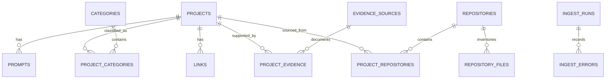

# 数据库 Schema

主数据库为 `data/catalog.sqlite`，采用 SQLite；网页端使用由数据库导出的 `site/data/catalog.json`。关系型数据库负责规范化与采集状态，JSON 负责静态网站读取。

## 实体关系



## 核心表

| 表 | 主键 | 作用 |
|---|---|---|
| `projects` | `id` | 作品本身；一条作品记录不等于一个仓库 |
| `categories` | `id` | 规范化分类词表 |
| `project_categories` | `(project_id, category_id)` | 多标签分类，保留原始分类标签 |
| `repositories` | `id` | 去重后的 GitHub 仓库，保存分支、许可证、克隆状态和 commit SHA |
| `project_repositories` | `(project_id, repository_id)` | 作品与仓库多对多映射，记录原作/镜像/合集关系和入口文件 |
| `links` | `id` | 在线演示、作者原帖等公开链接 |
| `prompts` | `id` | Prompt 的公开状态、原文链接和可选文本 |
| `evidence_sources` | `id` | 索引、帖子、原始仓库等证据来源 |
| `project_evidence` | 复合键 | 作品与证据的关系、证据类型和置信度 |
| `repository_files` | `id` | 克隆仓库的文件清单、扩展名、大小、SHA-256 和 HTML 入口标记 |
| `aliases` | 复合键 | 作品别名和历史名称 |
| `ingest_runs` | `id` | 每次采集运行的统计和状态 |
| `ingest_errors` | `id` | 克隆、解析、入口识别错误 |

## 重要字段语义

- `model_claim`：社区/作者对生成模型的声明，不等于独立验证。
- `model_confidence`：当前种子默认 `community_claim`。
- `relation_type`：`creator_original`、`third_party_mirror`、`collection`、`community_indexed_source`、`unverified_source_candidate`。
- `entry_confidence`：`explicit_override`、`source_link`、`title_path_match`、`unique_html`、`unresolved` 等。
- `playable_status=entrypoint_found`：只表示找到了 HTML 入口，不表示已经人工试玩或端到端验证成功。
- `license_spdx=NOASSERTION`：没有确认许可证；公开仓库不等于允许再分发。

## 初始数据快照

`data/seeds/games_52.tsv`、`games_51.tsv` 和 `mia_html_52.txt` 是可复现的紧凑种子清单；结合 5 个重点作品和 2 个额外单文件游戏，可重建首批 155 条作品。首轮导入后得到 54 个去重仓库、150 条作品-仓库关系。重复仓库只克隆一次，合集仓库里的多个作品仍是多条项目记录。

## 研究层表结构（2026-11-17）

基线表 projects、repositories、project_repositories 不重建、不自动提升社区模型声明。新增表的分工：

| 研究表 | 粒度与职责 |
|---|---|
| research_source_records | 按 (source, source_id) 保存当前来源快照；只计当前版本，不把旧删除数据算作新增 |
| research_posts | 精确 X status ID 作为帖子身份；缺失 ID 使用孤儿键；不等于独立游戏 |
| research_repositories | 83个 GitHub 候选仓库及与原创/镜像/工具/PR 的关系 |
| research_works | 64个作品工程映射、源码入口、Prompt/外部资源/人工贡献的源声明 |
| research_claims | 反证与模型归属冲突 |
| research_project_links | 旧目录到研究主表的保守精确映射，允许保留人工设置的关系 |
| research_work_reviews | APPROVED/DRAFT/REJECTED 的作品人工审核字段，独立于来源快照 |
| research_post_reviews | APPROVED/DRAFT/REJECTED 的原帖归并审核 |
| research_review_history | 只追加审核变更时间和依据，重复审核内容不制造伪新历史 |
| research_ingest_meta | 当前已经入库的来源快照 capture date |
| research_browser_runs | 将来真正浏览器实测的日志；空白不是已通过 |

一个 Work 可以关联多个来源帖；一个 GitHub 仓库也可能对应多款不同作品；同名和同仓库绝不能自动推断唯一作品。人工审核必须有直接证据 URL，不能修改来源冻结 JSON 再冒称作者事实。active manifest 的 SHA-256 对 sources/entities 两文件一起做内容校验，详见 RESEARCH_INTEGRATION.md。

## 运行实测状态（2026-11-17 新增）

`project_repositories.playable_status` 除既有取值外，新增两个由**隔离容器实测**得出的结论值：

| 取值 | 含义 | 是否可发布 |
|---|---|---|
| `entrypoint_found` | 找到 HTML 入口且相对静态资源齐全；**仅表示入口存在** | 是（仍需仓库在白名单内） |
| `sandbox_incompatible` | 隔离实测发现该产物在**必需的** iframe 沙箱（无 `allow-same-origin`）下会抛错（例如访问 `localStorage`），因此不可玩 | **否**，`build_site.py` 会跳过 |
| `runtime_verification_failed` | 隔离实测明确失败 | **否** |
| `not_checked` / `needs_review` / `missing_assets` / `requires_build` / `not_browser_based` | 未核实或已知缺条件 | 否 |

`collect_repositories.py` 的 `RUNTIME_REVIEWED_STATUSES` 保证**重新采集不会静默把这些实测结论改回可发布**，与"来源刷新不得覆盖人工审核层"是同一条原则。把某个产物改回可发布，必须显式修改数据库并附证据。

`entry_confidence` 新增 `runtime_reviewed`，表示该行入口结论来自运行实测而非文件树推断。

### 运行证据

* 报告由 `scripts/build_runtime_evidence.py` 聚合，落在 `data/reports/runtime-evidence-<date>.json`。
* `INPUT_RESPONSIVE` = 注入合成指针/键盘输入后**渲染输出发生可观测变化**。它不证明游戏正确、完整或归属。
* 聚合器是 fail-closed 的：若报告自称通过但带有控制台错误、被阻断的功能性依赖或没有输入驱动的变化，该条会被标记 `verification_rejected`，且**不计入** `gameplay_verified`。

### 隔离实测产生的状态（2026-11-17 全量普查）

`collect_repositories.py` 的 `RUNTIME_REVIEWED_STATUSES` 保证这些值在重新采集时**不会被覆盖回可发布**：

| 取值 | 含义 | 可发布 |
|---|---|---|
| `sandbox_incompatible` | 在必需沙箱（不含 `allow-same-origin`）下**必然失败**。实测两类：初始化即读 `localStorage`；自身 ES module 因不透明源 `origin 'null'` 被判 CORS 失败 | 否 |
| `runtime_requires_network` | 依赖外部 CDN 上的真实 JS（如 `cdnjs` 的 three.js）。隔离策略下无法运行；真实浏览器可加载，属**依赖分类**而非缺陷 | 否（隔离下不可验证） |
| `runtime_third_party_beacon` | 加载第三方分析脚本（如 `gc.zgo.at`）。被阻断即记为失败 | 否 |
| `runtime_optional_sensor_denied` | 触发 `Permissions policy violation`（如加速度计）。设备传感器不可用，通常是可接受的降级 | 否 |
| `runtime_no_interaction` | 能加载，但 15 个合成输入手势后渲染输出无变化 | 否 |
| `runtime_input_not_attributable` | 页面**自己就在重绘**（canvas 动画/着色器/时钟），因此"输入后像素变了"无法归因于输入。不能算成功，也不能算无交互 | 否 |
| `runtime_driver_timeout` | 页面阻塞驱动，被外部 `timeout -s KILL` 强制终止 | 否 |
| `runtime_needs_retest` | 测量不可靠（如 iframe 定位超时抖动） | 否 |

`playable_status` 语义分工：`entrypoint_found`＝入口存在；上述 `runtime_*`＝已实测且**不可发布**；
只有白名单仓库中 `entrypoint_found`/`smoke_test_passed` 的作品才会出现在站点试玩按钮上。

### 输入响应的归因规则（`input_responsive` vs `gameplay_verified`）

规则实现在 `scripts/input_attribution.py`，**探针与离线汇总器共用同一份实现**（汇总器必须能离线重判历史报告，所以这个模块刻意不依赖 Playwright）。

```
归因于输入  ⇐  (DOM 变了 且 空闲期 DOM 稳定) 或 (像素变了 且 空闲期像素稳定)
```

为什么这很重要：2026-11-17 的第一版普查把"输入后像素变了"直接当成响应输入，报出 11 条。
但其中 **10 条在空闲基线期间就已经在变**，而且 **7 条从加载到结束 DOM 字节完全相同**。
一个 canvas 动画/着色器页面无论有没有注入输入都会产生像素差异，所以那种差异什么也证明不了。
按修正规则重判，真正可归因的只有 **4 条**，其余 15 条记为 `INPUT_RESPONSE_NOT_ATTRIBUTABLE`。

字段分工，三者不能混用：

| 字段 | 含义 | 谁能设置 |
|---|---|---|
| `status` | 权威结论，例如 `INPUT_RESPONSIVE` | 探针按上述规则计算：汇总器会用原始证据重算 |
| `input_responsive` | 上述规则算出的正向事实（**机器能做出的最强主张**） | 自动化如上 |
| `gameplay_verified` | “玩法已验证” | **只能由 `build_runtime_evidence.py` 经人工审核后置位**；探针一律写 `False`，汇总产物里恒为 `0` |

`import_browser_report.py` 会**拒绝**任何自称 `gameplay_verified: true` 的自报报告；
汇总产物里的 `counts.gameplay_verified` 永远是 `0`，并有回归测试守住。
`counts.input_responsive` 才是机器允许下的最强主张。

### 把实测结论写进权威库（`apply_survey_to_catalog.py`）

在此之前，库里那些 `sandbox_incompatible` / `runtime_*` 行**没有任何写入者**：
只有 `collect_repositories.py` 的 `RUNTIME_REVIEWED_STATUSES` 在“保留”它们。
一个任何脚本都产生不了的结论是不可审计的，所以补上了这个写入者：

```bash
python3 scripts/collect_repositories.py --reclassify          # 1) 应用 config 修正
python3 scripts/consolidate_repo_survey.py --manifest ... --reports ... --out data/reports/repo-survey-<date>.json
python3 scripts/apply_survey_to_catalog.py --survey data/reports/repo-survey-<date>.json            # 2) 先看计划
python3 scripts/apply_survey_to_catalog.py --survey data/reports/repo-survey-<date>.json --apply    # 3) 写入
python3 scripts/mark_unvendored_entries.py --apply            # 4) 最后标未入库
python3 scripts/check_catalog.py                              # 5) 必须 problems: []
```

它按构造就是 fail-closed 的：

* **只会写限制性状态**。没有任何路径能通过它把作品变可发布：正向结果（`INPUT_RESPONSIVE`）留在证据文件里，
  只能经显式证据管道 + 人工发布批准才能上线。
* **拒绝不合格的证据文件**：缺 `captured_at`、缺隔离配置、或**作出结论的条目缺指纹**，一律拒跑——
  手写一份“普查”改不动库。（测量前就失败的条目不作结论，因此不会阻塞其他结论。）
* **绝不弱化既有结论**：新发现若比现有行更“宽松”，拒绝写入。
* 每行记下证据文件的 sha256，可回溯到产生它的那次测量。
* 只映射**本身即结论**的类别；“我们分不清”不写进库（`PASS`、`OTHER`、`DRIVER_FLAKE_OR_TIMEOUT`、
  `RENDERER_CRASHED_ENVIRONMENT_LIMIT` 都不对应任何状态）。

### 失败分类词表（`failure_class`）

分类的意义在于“产物失败了”不可行动，而这些结论指向完全不同的决定：

| 类别 | 含义 | 对应库状态 |
|---|---|---|
| `PASS` | 加载干净（`BROWSER_LOAD_CHECKED` / `INPUT_RESPONSIVE`） | 无 |
| `EXTERNAL_CDN_REQUIRED` | 依赖外部 CDN 上的真实 JS（依赖分类，非缺陷） | `runtime_requires_network` |
| `SANDBOX_OPAQUE_ORIGIN_BREAKS_OWN_SCRIPT` | 必需沙箱给帧一个不透明源，于是页面自身的 ES module 被判 CORS，或它读取 `localStorage`/`serviceWorker` 等同源限定 API 时抛错 | `sandbox_incompatible` |
| `THIRD_PARTY_ANALYTICS_BLOCKED` | 加载第三方分析脚本 | `runtime_third_party_beacon` |
| `OPTIONAL_DEVICE_SENSOR_DENIED` | `Permissions policy violation`（加速度计/全屏） | `runtime_optional_sensor_denied` |
| `INPUT_RESPONSE_NOT_ATTRIBUTABLE` | 页面持续自行重绘，输入响应无法分离 | `runtime_input_not_attributable` |
| `PAGE_BLOCKED_DRIVER` | 阻塞驱动，被外部 `timeout -s KILL` 终止 | `runtime_driver_timeout` |
| `NO_OBSERVABLE_RESPONSE` | 能加载，输入后无任何可观测变化 | `runtime_no_interaction` |
| `DRIVER_FLAKE_OR_TIMEOUT` | 驱动侧面问题（iframe 定位超时等），**不是**对产物的判断 | 无 |
| `RENDERER_CRASHED_ENVIRONMENT_LIMIT` | 渲染器崩溃：在本机 2 CPU / 4 GB 的 Docker VM 上属**环境上限**（SwiftShader + 1 GB 容器内存），不是产物属性 | 无 |
| `OTHER` | 尚未归类的失败 | 无 |

最后三类刻意不映射任何状态：它们是关于**我们的环境**或**尚未定性**的说法，不是关于产物的结论。

### 批量实测的运行纪律（2 CPU 的教训）

见 `docs/BROWSER_SMOKE.md`。要点：容器 stdout 就是进度流，**不要**为了看进度再起容器或 `docker exec` ——
本机 Docker Desktop 只有 2 个 CPU，额外的 docker 调用会把单条耗时从 3.5 秒推到分钟级，
这曾经是“突发快、随后停顿 4–17 分钟”的真正原因。

### 已检测 vs 已入库（`entrypoint_detected_not_vendored`）

第三方快照默认不入库（见 `.gitignore`），所以本地全量采集后，大多数入口行指向**不在仓库里**的文件。
`check_catalog.py` 对于 `entrypoint_found` 要求文件确实存在——这是正确的：否则一个干净克隆会声称
自己无法提供服务的入口。

因此提交前必须运行：

```bash
python3 scripts/mark_unvendored_entries.py            # 只报告
python3 scripts/mark_unvendored_entries.py --apply    # 把被 .gitignore 排除的入口改标为已检测未入库
python3 scripts/check_catalog.py                      # 必须 problems: []
```

### 声明的作品类型（`not_browser_based` / `requires_build`）

有些工作**根本不是浏览器程序**：`Prokopiy8247/Fable5-2-Natural-Disasters` 的游戏是 Unity 工程
（`Assets/`、`Builds/`、`PLAY.bat`），`Rolandjg/fableflight` 是 Rust 二进制，`Tarzno/tropical_island`
是 Godot 4 工程，`alex-slovakia/out-of-reach` 是 Unity 工程，`jreinach-alt/sf-gt` 是 C + `Makefile`。
这些仓库里**没有任何 HTML**，把它们永远留在 `needs_review` 会暗示"问题尚未查清"，而事实已经查清。

因此 `config/project_overrides.json` 可以声明 `playable_status`，但**只接受** `collect_repositories.py` 中
`DECLARED_REVIEWED_STATUSES` 列出的值：

| 取值 | 含义 |
|---|---|
| `not_browser_based` | 原生引擎/二进制，**不存在**浏览器入口 |
| `requires_build` | 需要先执行构建（Next.js、Vite、dev server）。例：`Aarosunn/SpaceApps` 的 EarthFM 是 Next.js 应用；`XDracam/spaceappschallenge2026` 的 `game/index.html` 引用 `%BASE_URL%` 与 `/src/main.tsx`，是打包器外壳而非静态页面 |

每条声明**必须**带 `note` 写明证据。运行时结论（`entrypoint_found`、`smoke_test_passed`、`sandbox_incompatible` 等）
**不在**允许声明的集合内：一份配置不能宣称没人测量过的结果（有回归测试守住这条）。

### 离线重分类（`--reclassify`）

修改 `config/project_overrides.json` 后不需要重新克隆 3.4 GB 快照：

```bash
python3 scripts/collect_repositories.py --reclassify        # 读 repository_files，无克隆、无网络
python3 scripts/mark_unvendored_entries.py --apply
python3 scripts/check_catalog.py
```

`classify_entrypoints()` 同时被克隆路径和重分类路径调用，因此两条路径的判定逻辑不会分叉。

### 装饰性引用不算缺失资源

`missing_static_assets()` 只报告**功能性**依赖。favicon、`apple-touch-icon`、web manifest、
`.ico/.woff/.woff2/.ttf/.otf/.eot` 一律跳过——运行时探针本来就把它们 stub 成空响应，
所以"缺 favicon"不可能是一个入口跑不起来的原因。修正前 `aaron-sulbaran/jester` 正因为三个
favicon 被判 `missing_assets`，而它的 `app/index.html` 本体完好；同一规则下
`bhoult/phone-games` 缺少的 `engine.js` 仍被正确报出。

该脚本用 `git check-ignore --stdin` 判断，所以结论不可能与 `.gitignore` 漂移。
`entrypoint_detected_not_vendored` **不参与发布**；重新运行 `collect_repositories.py` 会把文件取回本地，
再次变为 `entrypoint_found`。
